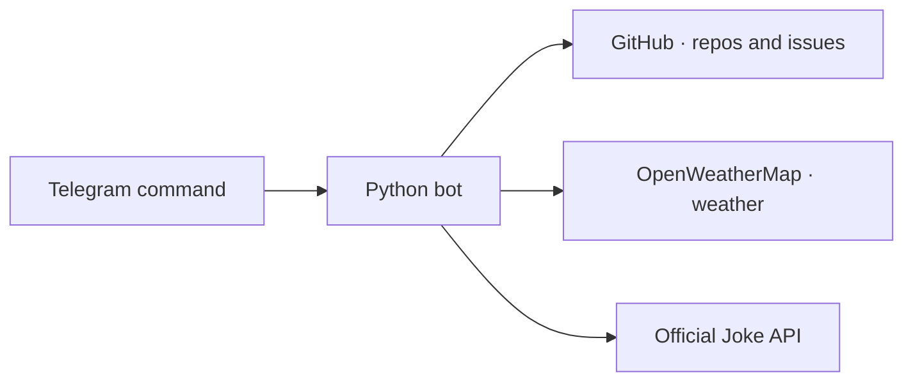

# Telegram Bot with GitHub, Weather, and Jokes Integration

This is a Python-based Telegram bot that connects to multiple external APIs to provide fun and useful commands:
- GitHub API → fetch repositories, branches, issues, pull requests, and top-starred projects
- OpenWeatherMap API → get live weather updates
- Official Joke API → deliver random jokes

---

## At a glance




## ✨ Features

✅ `/start` → Greet the user  
✅ `/repos <username>` → List all public repositories of a GitHub user  
✅ `/toprepos` → Show the top 10 most-starred public repositories on GitHub  
✅ `/branches <owner> <repo>` → List all branches in a GitHub repository  
✅ `/issues <owner> <repo>` → List open issues in a GitHub repository  
✅ `/pullreq <owner> <repo>` → List open pull requests in a GitHub repository  
✅ `/weather <city>` → Get the current weather (requires OpenWeatherMap API key)  
✅ `/joke` → Get a random joke

---

## 🚀 Setup Instructions

### 1️⃣ Clone this repository

```bash
git clone https://github.com/Fadi7AY/Telegram_bot.git
cd Telegram_bot

```

## Configuration and entry point

The implementation imports `requests`, `python-dotenv` and the legacy
`python-telegram-bot` interface (`Updater` / `Filters`). Use a dependency environment compatible with that interface.

Create a local `.env` file with the exact names read by the script:

```dotenv
TElEGRAM_TOKEN=your_telegram_bot_token
OpenWeather=your_openweather_api_key
```

Then run `python3 bot.py`. Keep real credentials out of Git.
